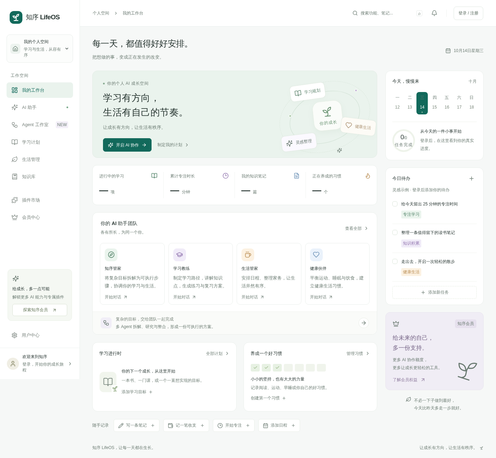
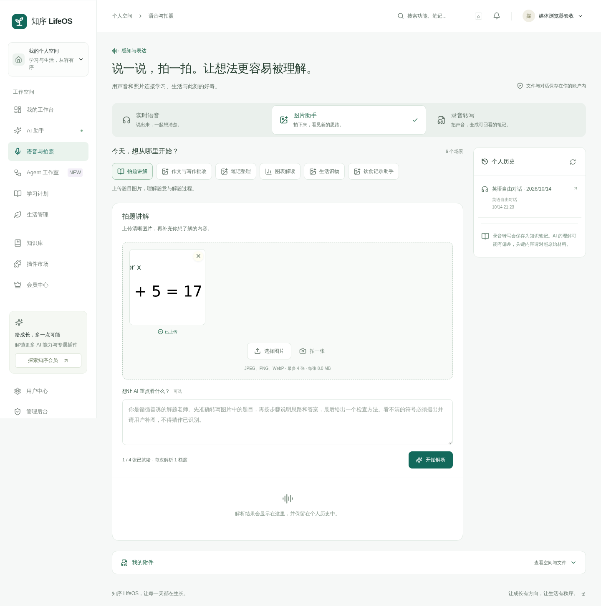
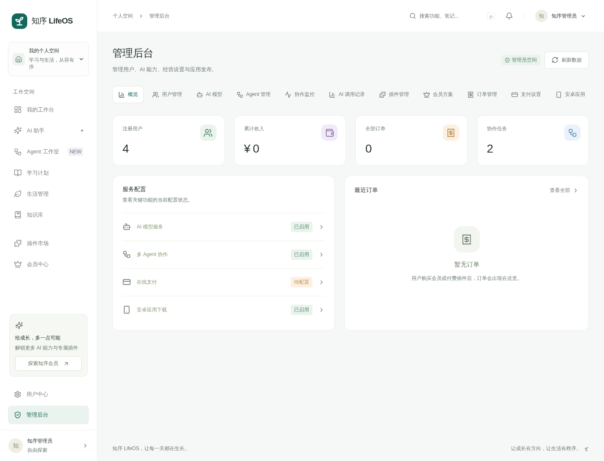

# 知序 LifeOS · AI 学习与个人成长系统

知序 LifeOS 是面向个人学习和知识管理的数字工作台，将目标、计划、笔记、学习资料、图片与语音内容、AI 辅助、提醒和数据复盘整合到一个系统中。

## 主要功能

- 学习目标、计划、任务、日程和进度管理。
- 笔记、知识条目、图片、附件和数学公式展示。
- AI 问答、内容整理、学习建议和对话历史。
- 语音实时交互、媒体处理和异步工作任务。
- 用户中心、权限、管理后台和 Android 客户端。
- 数据备份、操作日志和自动化回归测试。

## 产品界面







## 技术架构

- Next.js 16、React 19、Node.js 22。
- MySQL、独立 Worker、语音 WebSocket 服务。
- React Markdown、KaTeX、Sharp、Playwright。
- Nginx、systemd 和 HTTPS 部署。

## 环境要求

- Node.js 22+、npm 10+、MySQL 8.0。
- 图片处理所需的系统库；语音和媒体功能需要 HTTPS。

## 本地安装

```bash
git clone https://github.com/CharlesYin1204/zhixu-lifeos.git
cd zhixu-lifeos
npm ci
cp .env.example .env.local
npm run db:init
npm run dev
```

访问 `http://localhost:3060`。需要异步任务时另开终端执行 `npm run worker`；需要语音服务时运行对应语音脚本或 service。

## 环境变量

| 配置 | 说明 |
| --- | --- |
| `DB_HOST`、`DB_PORT`、`DB_USER`、`DB_PASSWORD`、`DB_NAME` | MySQL 连接 |
| `APP_SECRET` | 会话和数据签名密钥 |
| `APP_URL` | 对外访问地址 |
| `ADMIN_EMAIL`、`ADMIN_PASSWORD` | 首次初始化管理员 |
| `AI_BASE_URL`、`AI_API_KEY` | AI 服务 |
| `VOICE_PORT` | 语音服务端口，默认 `3064` |

## 构建与测试

```bash
npm run build
npm run test:api
npm run test:browser
npm run db:backup
```

测试应使用隔离数据库和测试账号；真实媒体或 AI 测试可能产生外部调用。

## 生产部署

1. 安装 Node.js 22、MySQL、Nginx 并创建独立系统用户。
2. 执行 `npm ci`，创建权限为 `600` 的 `.env.local`。
3. 初始化新数据库或在备份后执行升级脚本。
4. 执行 `npm run build`，运行 API 和浏览器回归。
5. 使用 `deploy/zhixu-web.service` 运行 Web 服务，监听 `3060`。
6. 使用 `deploy/zhixu-worker.service` 运行异步任务。
7. 需要语音时启用 `deploy/zhixu-voice.service`，监听内部端口 `3064`。
8. 参考 `deploy/zhixu-nginx.conf` 或 HTTPS 配置反向代理并申请证书。
9. 配置数据库与私有媒体备份，定期进行恢复演练。

更新前执行 `npm run db:backup`，然后安装依赖、迁移、构建并依次重启 Web、Worker 和语音服务。

## 项目结构

- `app/`：页面和 API。
- `components/`：界面组件。
- `lib/`：业务、媒体、鉴权和数据库。
- `scripts/`：初始化、Worker、测试、备份和 Android 构建。
- `deploy/`：Nginx 与 systemd 配置。
- `docs/screenshots/`：产品截图。

## 常见问题

- Worker 不处理任务：检查 Worker 服务、数据库和任务状态。
- 图片无法处理：检查 Sharp 安装、文件权限和磁盘空间。
- 语音连接失败：确认 HTTPS、代理 WebSocket 配置和 `VOICE_PORT`。
- 登录循环：核对 `APP_URL`、Cookie 安全设置和代理协议头。

## 联系方式

微信：`charlesyin6015`

## 开源与二次开发

本项目采用 [MIT License](LICENSE) 开源。你可以点击 GitHub 页面右上角的 **Fork** 创建自己的副本，也可以克隆后创建新分支进行修改：

```bash
git checkout -b feature/my-change
```

请勿提交 `.env`、数据库备份、用户数据或任何真实密钥；部署前请根据 `.env.example` 创建自己的环境配置。
